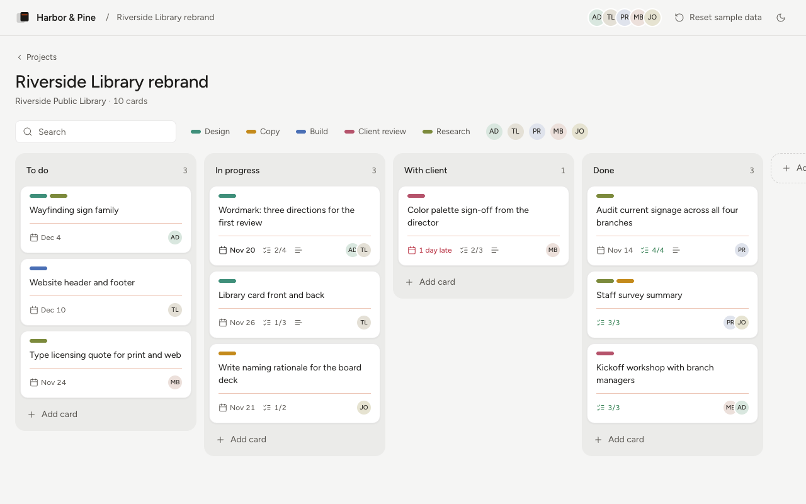

# Harbor & Pine Boards: kanban board template

A free kanban board template for small teams: projects, columns, drag and drop cards, and a card drawer with checklists, labels, people and due dates. Saved in the browser, static, no backend.



[](https://console.cloudzyro.com/new?repo=https://github.com/Cloudzyro/template-kanban)

## What's included

- Project list with every board's progress by column, who's on it, what's next, and a "Coming up" list of due cards across all boards
- Board view with columns you can add, rename and delete (when empty), and cards you add inline
- Drag and drop with the mouse, touch (press and hold) or keyboard: focus a card's move button, press Space, use the arrow keys (left and right change column, up and down change position), Space to drop, Escape to cancel. Screen readers hear where the card is at each step
- Card drawer: title, column, due date, labels, people, notes and a checklist with progress; Escape closes it and focus returns to the board
- Search and filters by label and person
- Due dates that turn into "Due today", "Due tomorrow" or "3 days late", and stay quiet once a card is done
- Everything saved in the browser's localStorage, with "Reset sample data" to start over
- Light and dark themes (follows the system, remembers the choice), hash routing for any static host, reduced motion respected

## Run it locally

```bash
pnpm install
pnpm dev        # http://localhost:5173
pnpm build      # static site in dist/
pnpm preview    # serve the built site
```

## Make it yours

- **Workspace, people, labels, projects and cards:** all in `src/data/boards.ts`. Change the names, add members (initials and a soft background tone), rename the labels and their colors, and write your own boards and cards.
- **Today's date:** the sample data is fixed to November 18, 2026 so the "late" and "due soon" states always show. Set `workspace.today` to `null` in `src/data/boards.ts` to use the real date.
- **Saved boards:** once someone uses the app, their boards live in their own browser. After editing `src/data/boards.ts`, click **Reset sample data** to see your changes. The storage code is in `src/lib/store.ts`; swap its functions for calls to your own API (Supabase, a REST endpoint) to share boards between people.
- **Colors:** CSS variables in `src/index.css` (`:root` for light, `.dark` for dark). `--accent` is the marker orange for the main button and the thin rule under each card title (`--rule`); `--late` is for overdue dates.
- **Font:** Figtree, self-hosted through Fontsource and imported at the top of `src/index.css`.
- **Social card and icon:** replace `public/og-image.png` (1200x630) and `public/favicon.svg`.

Optional build-time variables:

| Variable | What it does |
| --- | --- |
| `VITE_SITE_URL` | Your public address, used for the social card and sitemap |
| `VITE_ALLOW_INDEXING` | Set to `true` to let search engines index the site. Off by default, since boards are usually private |

## Routing on static hosts

The app uses a hash router, so addresses look like `/#/board/riverside-library`. The part after `#` never reaches the server, so deep links and refreshes work on nginx, Cloudzyro, GitHub Pages or any static host with no rewrite rules. The build also writes `dist/404.html`, so a mistyped path still opens the app.

## Deploy

Click the **Deploy to Cloudzyro** button above, or push your own copy to GitHub and connect it in the Cloudzyro console. The build command is `pnpm build` and the output folder is `dist`. No server is needed.

## Stack

- [React](https://react.dev) 19 and [React Router](https://reactrouter.com) 8 (hash router)
- [dnd kit](https://dndkit.com) for pointer, touch and keyboard drag and drop
- [Vite](https://vite.dev) 8 and [Tailwind CSS](https://tailwindcss.com) 4
- TypeScript

## License

MIT, see [LICENSE](./LICENSE).
